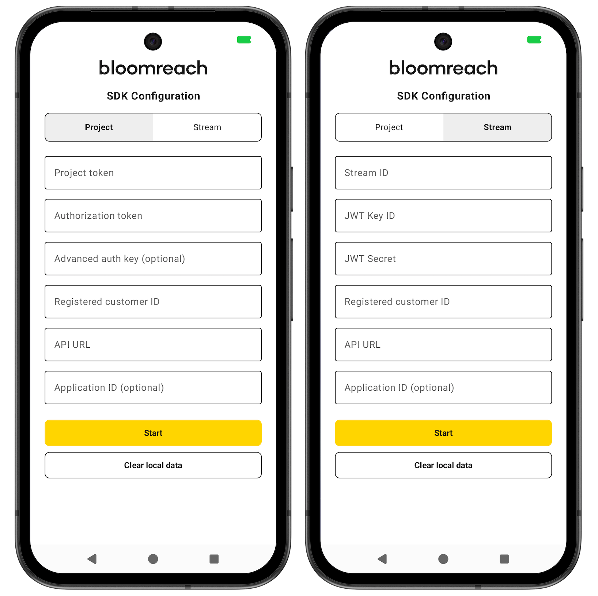
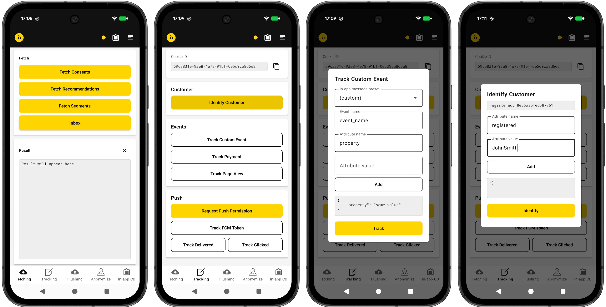
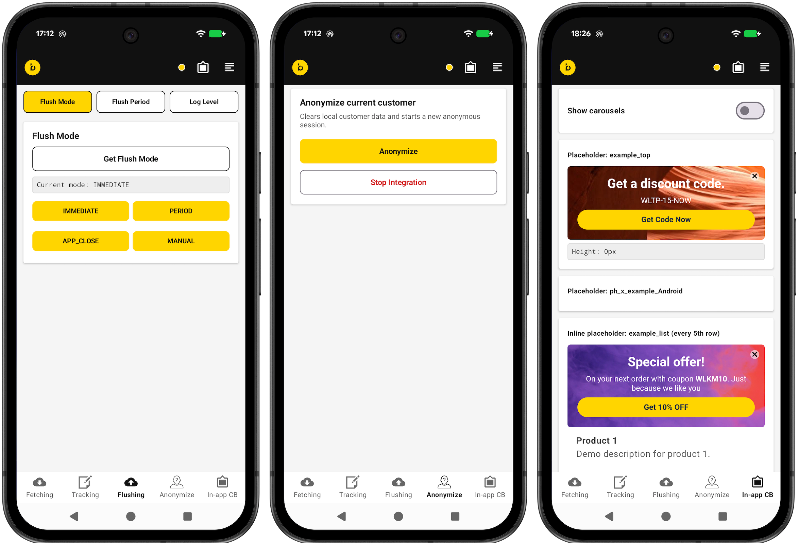

The Exponea Android SDK includes an example application you can use as a reference implementation. You can build and run the app, test {user.mkg} features, and compare the code and behavior of your implementation with the expected behavior and code in the example app.

## Prerequisites

You must have the following software installed to be able to build and run the example app:

- [Android Studio](https://developer.android.com/studio) with a [virtual device](https://developer.android.com/studio/run/managing-avds) set up

## Build and run the example app

1. Clone the [exponea-android-sdk](https://github.com/exponea/exponea-android-sdk) repository on GitHub:
   ```shell
   git clone https://github.com/exponea/exponea-android-sdk.git
   ```
2. Open the `exponea-android-sdk` project in Android Studio.
3. Open the file `sdk/build.gradle` and find the following line 
   ```groovy
   apply from: 'publish-maven.gradle'
   ```
   Comment it out so it looks like this:
   ```groovy
   //apply from: 'publish-maven.gradle'
   ```
4. Run the example app on the Android emulator (`Run` > `Run 'app'` or Ctrl + R).

> 📘
>
> To enable push notifications in the example app, you must also configure the [Firebase Cloud Messaging for Android SDK](https://documentation.bloomreach.com/engagement/docs/android-sdk-firebase) or [Huawei integration](https://documentation.bloomreach.com/engagement/docs/android-sdk-huawei) in the {user.mkg} web app. Use the `gms` product flavor for Firebase or the `hms` flavor for Huawei.

## Navigate the example app



Run the app in the emulator to open the **SDK Configuration** screen. The fields change depending on the selected integration type. Here's how to set it up:

1. Select your integration type using the **Project** or **Stream** toggle.
2. For **Project**:
   - Enter your **Project token**.
   - Enter your **Authorization token** (API key).
   - **Optional:** Enter **Advanced auth key (optional)** to enable [customer token authorization](https://documentation.bloomreach.com/engagement/docs/android-sdk-authorization#customer-token-authorization).
3. For **Stream**:
   - Enter your **Stream ID**.
   - **Optional:** Enter **JWT Key ID** and **JWT Secret** to enable local JWT token generation for testing. Both must be provided together. Refer to [SDK auth token authorization](https://documentation.bloomreach.com/engagement/docs/android-sdk-authorization#sdk-auth-token-authorization) for details.
4. Enter the **API URL** (API base URL for the {user.br} platform).
5. **Optional:** Enter an email address hard ID in the **Registered customer ID** field to identify the customer. Leave blank for anonymous tracking.
6. **Optional:** Enter **Application ID (optional)** if your {user.mkg} project supports multiple mobile apps. If you leave this blank, the SDK uses the default value `default-application`. [Learn more about Configuration for Android SDK](https://documentation.bloomreach.com/engagement/docs/android-sdk-configuration).
7. Click **Start** to [initialize the SDK](https://documentation.bloomreach.com/engagement/docs/android-sdk-setup#initialize-the-sdk).

The **Clear local data** button invokes `Exponea.clearLocalCustomerData()` to delete all locally stored data without initializing the SDK.

> [`AuthScreen.kt`](https://github.com/exponea/exponea-android-sdk/blob/main/app/src/main/java/com/exponea/example/ui/auth/AuthScreen.kt)
> [`SdkInitializer.kt`](https://github.com/exponea/exponea-android-sdk/blob/main/app/src/main/java/com/exponea/example/config/SdkInitializer.kt)

> 👍
>
> When using **Project** integration, prefix your API key with `Token `, for example:
> `Token 0b7uuqicb0fwuv1tqz7ubesxzj3kc3dje3lqyqhzd94pgwnypdiwxz45zqkhjmbf`.



After initialization, the main screen provides bottom navigation to test different SDK features. The app bar also includes an SDK status indicator, a configuration drawer, and a logs bottom sheet.

- The **Fetching** screen enables you to fetch consents, recommendations, and segments, and open the app inbox.
  > [`FetchingScreen.kt`](https://github.com/exponea/exponea-android-sdk/blob/main/app/src/main/java/com/exponea/example/ui/fetching/FetchingScreen.kt)
  
- The **Tracking** screen enables you to test tracking of different events and properties. It also provides options to set the SDK auth token and identify customers with auth tokens. The **Track Custom Event** and **Identify Customer** actions open separate dialogs to enter test data.
  > [`TrackingScreen.kt`](https://github.com/exponea/exponea-android-sdk/blob/main/app/src/main/java/com/exponea/example/ui/tracking/TrackingScreen.kt)
  > [`IdentifyCustomerDialog.kt`](https://github.com/exponea/exponea-android-sdk/blob/main/app/src/main/java/com/exponea/example/ui/dialogs/IdentifyCustomerDialog.kt)
  > [`TrackCustomEventDialog.kt`](https://github.com/exponea/exponea-android-sdk/blob/main/app/src/main/java/com/exponea/example/ui/dialogs/TrackCustomEventDialog.kt)

- The **Flushing** screen lets you read and change the flush mode and flush period, trigger a manual data flush, and check the SDK log level.
  > [`FlushingScreen.kt`](https://github.com/exponea/exponea-android-sdk/blob/main/app/src/main/java/com/exponea/example/ui/flushing/FlushingScreen.kt)

- The **Anonymize** screen lets you anonymize the current user and stop the SDK integration.
  > [`AnonymizeScreen.kt`](https://github.com/exponea/exponea-android-sdk/blob/main/app/src/main/java/com/exponea/example/ui/anonymize/AnonymizeScreen.kt)

- The **In-app CB** screen displays in-app content blocks in Jetpack Compose. Use placeholder IDs `example_top`, `ph_x_example_Android`, `example_list`, `example_carousel`, and `example_carousel_and` in your in-app content block settings. An XML-based content blocks screen is also available from this screen.
  > [`ContentBlocksScreen.kt`](https://github.com/exponea/exponea-android-sdk/blob/main/app/src/main/java/com/exponea/example/ui/contentblocks/ContentBlocksScreen.kt)
  > [`ContentBlocksXmlFragment.kt`](https://github.com/exponea/exponea-android-sdk/blob/main/app/src/main/java/com/exponea/example/ui/contentblocks/ContentBlocksXmlFragment.kt)
  > [`fragment_content_blocks.xml`](https://github.com/exponea/exponea-android-sdk/blob/main/app/src/main/res/layout/fragment_content_blocks.xml)

Try out the different features in the app, then find the customer profile in the {user.mkg} web app (under `Data & Assets` > `Customers`) to see the properties and events tracked by the SDK.

If you left the **Registered customer ID** field blank, the customer is tracked anonymously using a cookie soft ID. You can look up the cookie value in the logs bottom sheet and find the corresponding profile in the {user.mkg} web app.

If you entered a hard ID — for example, an email address — in the **Registered customer ID** field, you can find the customer in the {user.mkg} web app by their email address.

> 📘
>
> Refer to [Customer identification](https://documentation.bloomreach.com/engagement/docs/customer-identification) for more information on soft IDs and hard IDs.



## Troubleshooting

If you encounter any issues building the example app, the following may help:

- In Android Studio, select `Build` > `Clean Project`, then `Build` > `Rebuild Project`.
